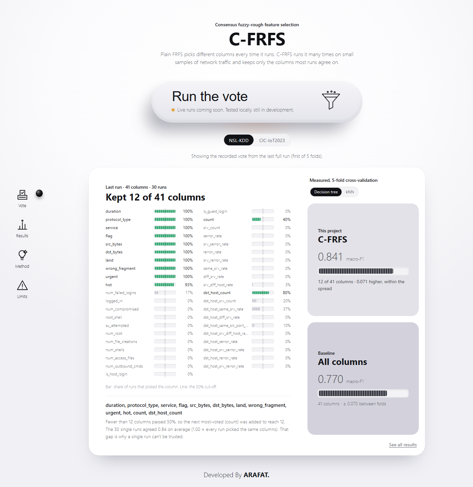

# C-FRFS — Consensus Fuzzy-Rough Feature Selection

**Live demo: [cfrfs.arafatcodes.dev](https://cfrfs.arafatcodes.dev)**

Network intrusion detection works on traffic records with dozens of columns, and most of them do not help to spot attacks. Fuzzy-rough feature selection (FRFS) picks a small set of the *original* columns, so the result stays readable, unlike PCA. But FRFS is unstable: run it on a different sample and it picks different columns.

C-FRFS runs FRFS many times on small random samples and keeps only the columns that at least half of the runs agree on.



A team project for a university Granular Computing course.

## Method

```
data ──► sample 300 rows ×30 ──► FRFS on each ──► majority vote (≥ 50%) ──► kept columns ──► kNN / decision tree
```

- **Datasets:** NSL-KDD (41 columns, 5 classes) and CIC-IoT2023 (39 columns, benign + 7 attack families), each capped at 20,000 rows.
- **Evaluation:** stratified 5-fold cross-validation, macro-F1, kNN and a decision tree, with k = 12 columns for every method.
- **Compared with:** all columns, a single FRFS run (300 and 1,000 rows), mutual information, chi-squared and PCA.

## Findings

All numbers are macro-F1 means over 5 folds, read from the `results_*` folders in this repo. Differences smaller than the fold-to-fold spread are treated as ties.

1. **The vote makes the selection repeatable.** On NSL-KDD, two independent C-FRFS runs agree on 0.94 of their columns (Jaccard), against 0.84 for two single FRFS runs.
2. **It does not make detection more accurate.** On NSL-KDD with a decision tree, C-FRFS scores 0.841 ± 0.086 and a single FRFS run 0.834 ± 0.088, a tie. On CIC-IoT2023 (8 classes), using all 39 columns (0.641) beats every 12-column set, C-FRFS included (0.603).
3. **A flaw in the baseline, found and fixed.** On 300 rows, FRFS reaches its best possible score after about 3 columns. The remaining picks are ties, and the library settles them by column order, so most of the "12 selected columns" were simply the first columns in the file. That inflated the earlier stability numbers. A re-run that breaks ties at random (`--random-ties`, folders `results_fixed_rt*`) shows the honest picture:
   - The vote keeps only about 3 columns.
   - Accuracy drops, e.g. NSL-KDD decision tree 0.642 against 0.770 with all columns.
   - The vote is far more stable across folds than a single FRFS run: 0.64 against 0.26 on NSL-KDD, and 0.85 against 0.23 on CIC-IoT2023.

## Repository

| Path | What it is |
|---|---|
| `src/cfrfs.py` | C-FRFS: sampling, one FRFS run, the vote, Jaccard stability |
| `src/data.py`, `src/cici.py` | NSL-KDD and CIC-IoT2023 loaders |
| `src/baselines.py` | all columns, MI, chi-squared, PCA, single FRFS |
| `src/evaluate.py`, `src/run_all.py` | 5-fold experiment and command-line entry point |
| `src/attack_map.py`, `src/figures.py`, `src/robustness.py`, `src/reproduce.py` | per-class columns, charts, sample-size sweep, determinism check |
| `scripts/` | CIC-IoT2023 download and the FRFS saturation curve |
| `webapp/` | the web page, a small local server, and the static-site builder |
| `results*/` | result tables (JSON/CSV) and charts for every run |

## Run it

Python 3.12. FRFS cost grows with the square of the row count, so it is only ever run on samples of 300–1,000 rows.

```bash
python -m pip install -r requirements.txt

# NSL-KDD (not included in this repo)
mkdir data
curl -L -o data/KDDTrain.txt "https://cdn.jsdelivr.net/gh/defcom17/NSL_KDD@master/KDDTrain+.txt"

python -m src.cfrfs                                   # quick self-test
python -m src.run_all --fixed --runs 30               # full experiment, about 25 min on CPU
python -m src.run_all --fixed --random-ties --runs 30 # with random tie-breaking

# CIC-IoT2023: python scripts/fetch_cici2023.py, then --dataset cici2023 --labels group

# web page
python -m webapp.build_static                         # static site in webapp/dist/
```

## Data

The datasets are not included.

- **NSL-KDD:** Tavallaee et al., *A Detailed Analysis of the KDD CUP 99 Data Set*, 2009.
- **CIC-IoT2023:** Neto et al., *CICIoT2023*, Sensors 23(13), 2023. The script samples a third-party Hugging Face copy, at most 20,000 rows per label.

## Limits

- One seed, one 20,000-row sample, and k = 12 not tuned.
- NSL-KDD is not IoT traffic.
- NSL-KDD's rarest class (U2R) has only 8 rows.
- Results move slightly between library versions; the exact versions are in `requirements-lock.txt`.

## References

- Jensen & Shen, *New Approaches to Fuzzy-Rough Feature Selection*, IEEE TFS 17(4), 2009
- Jensen & Shen, *Semantics-Preserving Dimensionality Reduction*, IEEE TKDE 16(12), 2004
- Lenz et al., *fuzzy-rough-learn 0.1*, IJCRS 2020

## License

MIT, see [LICENSE](LICENSE). The bundled Lexend font is under the SIL Open Font License.
